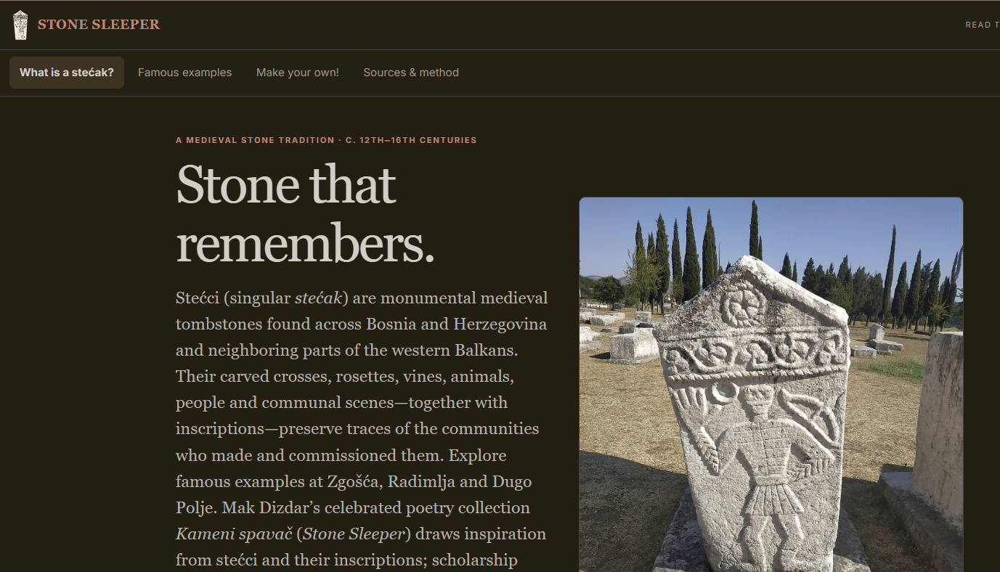
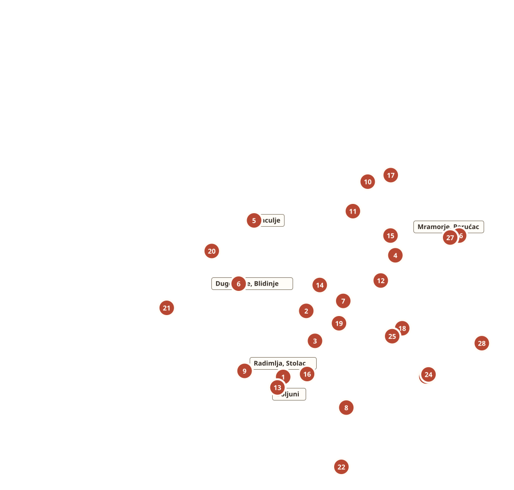

# Stone Sleeper

Explore medieval **stećci** through a source-led guide, then make a design of your own. Stone Sleeper includes a five-step 2D design activity and a 3D carving mode. Historical claims link to institutional or scholarly sources; custom motif drawings are interpretive studies, not archaeological reproductions.

## Explore and create

- Read about the stećak tradition and browse documented monuments, inscriptions, and sites.
- Explore a regional map of UNESCO-listed necropolises and selected additional sites.
- Compose a 2D stone design with motifs, an inscription, and ageing effects; the app also offers a 3D carving mode.
- Find citations, image credits, and notes on method in the **Sources & method** section of the app.

The map marks 28 UNESCO component sites and selected other locations; it is not an exhaustive inventory or a current census. Relief-map background by DzWiki and NordNordWest, adapted with site markers, **CC BY-SA 3.0** ([source and license](https://commons.wikimedia.org/wiki/File:Bosnia_and_Herzegovina_relief_location_map.svg)). UNESCO coordinates: [UNESCO map](https://whc.unesco.org/en/list/1504/maps/); additional site records: [Stećak.map](https://stecakmap.info/).

## Install

Find **Stone Sleeper** in the Möbius App Store, or install it from its public manifest:

`https://raw.githubusercontent.com/SelverPepic/stone-sleeper/main/mobius.json`

## Attribution and method

Photograph credits and licenses are shown with the images and in the app's **Sources & method** section. AI-assisted explanatory writing and illustrations are labeled in the app. Motifs are visual interpretations, not facsimiles or exact reconstructions; the app is an educational introduction, not a scholarly text edition.
